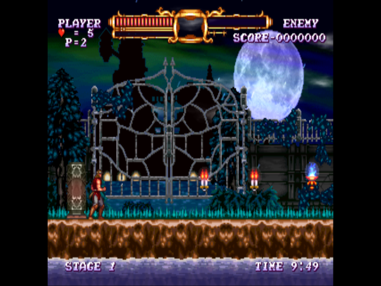

# Castlevania: The Adventure ReBirth - native recompilation

A static recompilation of **Castlevania: The Adventure ReBirth** (WiiWare, NTSC-U, title `WD9E`) to native code. The
game's PowerPC executable is translated to C++ and runs on Windows (and Linux) with a small runtime
that replaces the Wii hardware, IOS and the DSP. The game logic, Nintendo SDK and NW4R sound library
run as recompiled code.



**No game data is included.** You need your own copy of the game as a WAD. The build turns your WAD
into a `game` folder and generates the C++ from the executable inside it.

## Status

- Boots through the health screen, Konami logo, save creation, title and Stage 1 gameplay with the
  HUD and stage timer running (headless Linux test build).
- A Windows build has been produced but not yet play-tested on Windows.
- Audio runs but has not been verified by ear. The game draws a pillarboxed 4:3 picture in 16:9 mode.
- v0.2: fixes carried over from Chocobo's Dungeon - audio (no dropped audio periods, DSP-done delivered first, 60 ms jitter buffer), game speed 1x-8x (the unlimited mode could lock the game), depth and format EFB copies.

Castlevania ReBirth runs on the same M2 engine and the same Nintendo SDK build as Contra ReBirth;
this repository shares its recompiler and runtime with
[contra-rebirth-recomp](https://github.com/darkuni/contra-rebirth-recomp) and differs only in the
per-game addresses (`src/runtime/game.h`, the idle loop in `src/recomp.py`) and the symbols.

See [NOTES.md](NOTES.md) for the technical write-up: binary layout, symbol naming, per-game
constants and every runtime change.

## Layout

| Path | What it is |
| --- | --- |
| `src/recomp.py` | Recompiler: `main.dol` + symbols -> `src/gen/*.cpp` (one C++ function per guest function) |
| `src/runtime/` | Runtime: CPU context and memory, threads, IOS (ES/FS/NAND), GX -> OpenGL 3.3, AX audio mixer, input |
| `src/runtime/game.h` | Castlevania-specific addresses the runtime needs |
| `src/hle.txt` | Guest functions replaced by host code or stubbed |
| `config/symbols.txt` | Function/object symbols (dtk analysis + library naming); `symbols.dtk.txt` is the raw dtk output |
| `config/splits.txt`, `config.yml` | decomp-toolkit (dtk) project files |
| `tools/prepare_wad.py` | Unpacks a WAD into the `game` folder (decrypts contents, decompresses the DOL) |
| `tools/match.py`, `tools/xmatch.py`, `tools/apply_xmatch.py` | Library naming passes used to build `config/symbols.txt` |

## Building

Requirements: Python 3.11+, `pip install libWiiPy` (WAD unpacking), CMake, Ninja, a C++17 compiler.
Windows builds are cross-compiled with mingw-w64 (posix threads) and the SDL2 mingw development package.

```sh
# 1. Unpack your WAD into ./game (main.dol, tmd.bin, ticket.bin, content/*.app)
python3 tools/prepare_wad.py Castlevania_ReBirth_NTSC-U.wad game

# 2. Generate the C++ from the executable
cd src
python3 recomp.py ../game/main.dol ../config/symbols.txt gen 300

# 3a. Windows exe (cross-compiled)
cmake -S . -B build-win -G Ninja -DCMAKE_TOOLCHAIN_FILE=mingw.cmake \
      -DSDL2_DIR=/path/to/SDL2-2.30.x/x86_64-w64-mingw32
ninja -C build-win -j1          # the generated code is large; -j1 keeps memory use down

# 3b. Linux headless test build (EGL, writes screenshots)
cmake -S . -B build -G Ninja -DCMAKE_CXX_COMPILER=clang++
ninja -C build
SHOT_EVERY=150 SHOT_DIR=shots TIMEOUT=120 ./build/castlevania ../game
```

`prepare_wad.py` checks that the DOL matches the one this recompilation was made from
(sha1 `69795df60bdeae8faa8905f20f9c8af8455f3c53`). A different build of the game needs its own
symbols and `game.h` addresses.

## Running (Windows)

Put `castlevania.exe`, `SDL2.dll`, `libwinpthread-1.dll` and the `game` folder side by side, then
run the exe (or `castlevania.exe <path to game folder>`). Saves go in a `nand` folder next to
`game`; settings in `castlevania.ini` (F1 / Esc opens the settings menu in game).

Controls (sideways Wii Remote): arrows = move, X = 2, Z = 1, A = A, S = B, Enter = +.
Gamepad: d-pad/stick = move, A = 2, B = 1, X = A, Y = B, Start = +. Hold Tab for fast-forward.

## Credits

- [decomp-toolkit (dtk)](https://github.com/encounter/decomp-toolkit) for DOL analysis and splitting.
- Symbol lists from public decompilation projects (doldecomp/ogws, SeekyCt/spm-decomp, doldecomp/mkw,
  doldecomp/brawl, zeldaret/ss, xbret/xenoblade) were used to name SDK and library functions.
- [Dolphin](https://github.com/dolphin-emu/dolphin): ES view formats used as a reference; the
  system-font replacements embedded in `src/runtime/ipl_fonts.h` are Dolphin's Droid Sans fonts
  (Apache License 2.0, see `src/runtime/ipl-font-licenses.txt`).
- [libWiiPy](https://github.com/NinjaCheetah/libWiiPy) for WAD unpacking.

Castlevania: The Adventure ReBirth is © Konami. This project contains no Konami code or assets.

## Disclaimer

This is an unofficial fan project. It is **not affiliated with, endorsed by, or sponsored by** Konami Digital Entertainment, M2 Co., Ltd.
or Nintendo. *Castlevania: The Adventure ReBirth* and all related names and marks belong to their respective owners. This
repository contains no game code or game data; you need your own legally obtained copy of the game.

## License

The project's own code is released under the [MIT License](LICENSE). Bundled third-party
components (fonts, OpenGL headers) keep their own licenses; see
[THIRD_PARTY_NOTICES.md](THIRD_PARTY_NOTICES.md).
